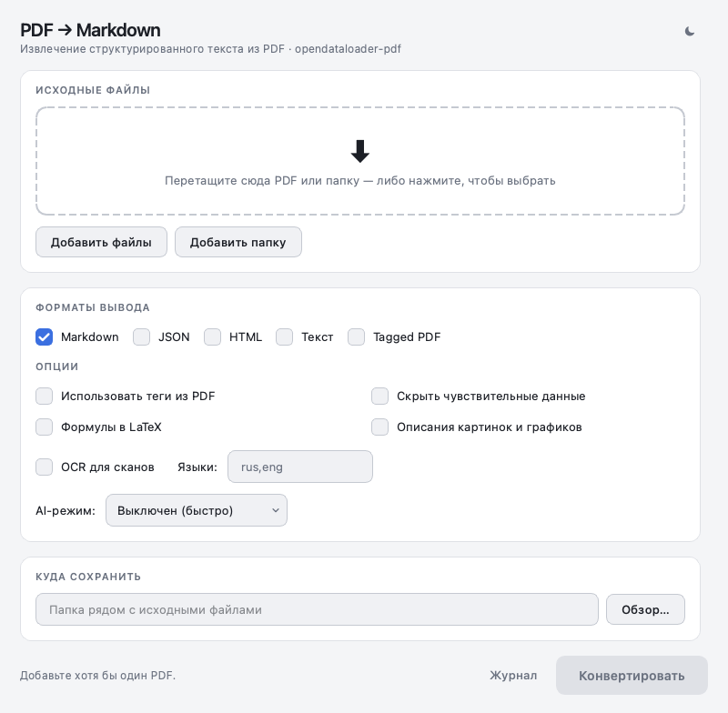

# PDF → Markdown

Desktop front-end for
[opendataloader-pdf](https://github.com/opendataloader-project/opendataloader-pdf),
aimed at people who never open a terminal: drag PDFs in, tick the options,
press one button.



## Features

- Drag & drop for PDF files and whole folders
- Output as Markdown, JSON, HTML, plain text or tagged PDF
- OCR for scans, LaTeX formulas, picture descriptions, data sanitising
- Light and dark theme, follows the system setting on start
- Runs the conversion off the UI thread, with a log that unfolds on demand

## Requirements

- Python 3.10+
- Java 11 or newer (`opendataloader-pdf` runs a JVM under the hood)

## Run from source

```
python -m venv .venv
source .venv/bin/activate        # Windows: .venv\Scripts\activate
pip install -r requirements.txt
python gui.py
```

## Build a Windows installer

See [BUILD.md](BUILD.md). Short version: build on Windows (PyInstaller does not
cross-compile), bundle a trimmed JRE with `jlink`, wrap it with Inno Setup.

## Layout

| File | Purpose |
|---|---|
| `gui.py` | Window, drag & drop, conversion worker thread |
| `theme.py` | Colour palettes and generated stylesheet |
| `app.spec` | PyInstaller build definition |
| `installer.iss` | Inno Setup installer script |
