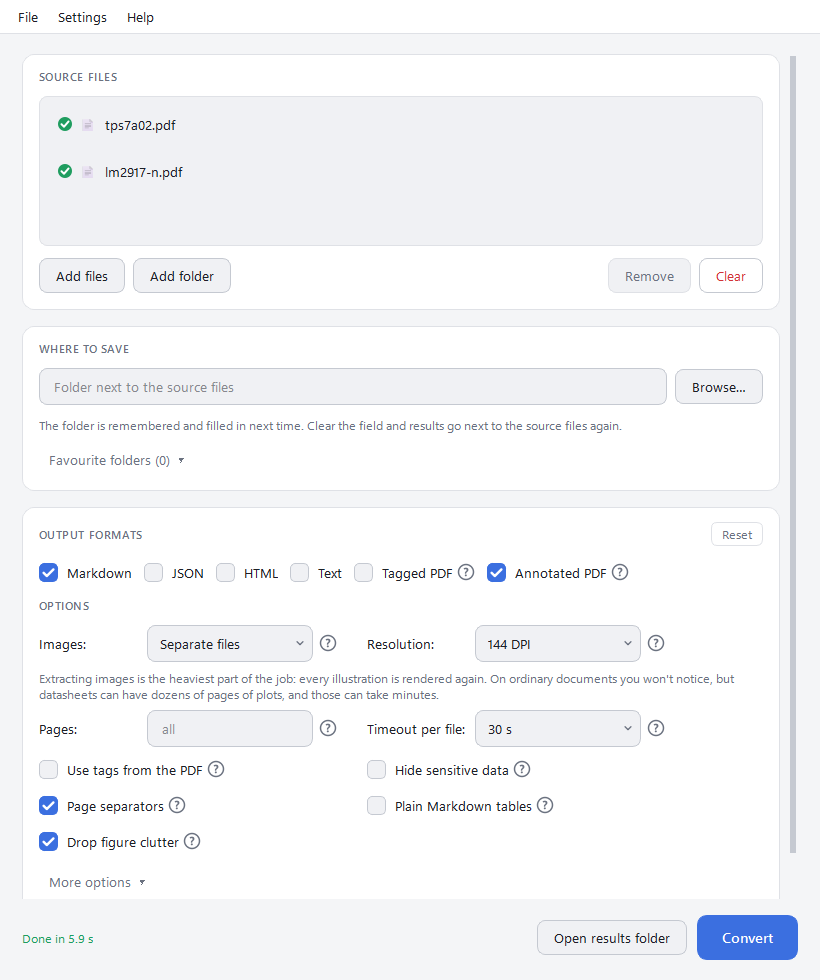

#  PDF → Markdown

[Русская версия](README.ru.md)

A Windows desktop app that turns PDFs — technical documents and datasheets
especially — into Markdown, JSON, HTML or plain text. Drag files in, press one
button. No terminal, no Python, no Java to install.

Built on [opendataloader-pdf](https://github.com/opendataloader-project/opendataloader-pdf).

<picture>
  <source media="(prefers-color-scheme: dark)" srcset="docs/screenshot-en-dark.png">
  
</picture>

## Download

Get `PDF-to-Markdown-Setup.exe` from the
[Releases page](https://github.com/k1llrouz/pdf-to-md-ui/releases) and run it.
Windows 10 or 11, 64-bit. Java comes with the program.

The installer is not code-signed, so Windows SmartScreen may say it "protected
your PC" on first run: click **More info → Run anyway**.

## How to use

1. Drag PDFs or a whole folder into the window or onto the program's icon —
   or right-click them in Explorer and pick **Open in PDF → Markdown** (on
   Windows 11 it is under **Show more options**).
2. Tick the output formats. Optionally choose where to save; by default the
   results go to an `output` folder next to the sources.
3. Press **Convert**.
4. A mark next to each file tells how it went — hover it for details.
   Double-click a converted file to open the result.

A file you don't need comes off the list with **Remove** or the Delete key.
Every setting has a **?** that explains it, and **Help → User guide** (F1)
walks through everything — [English](docs/guide.en.md),
[Russian](docs/guide.ru.md); it is built into the program and works offline.

## What it does well

- **Tables survive.** Markdown keeps tables as HTML, so merged cells — the
  backbone of a datasheet's Electrical Characteristics — stay intact. Plain
  Markdown tables are one tick away for editors that don't show HTML.
- **Big files don't hang it.** Every file has a timeout, a file that runs over
  is retried without images, and **Cancel** really stops the work. One broken
  PDF never stops the rest of the batch.
- **Plot-heavy datasheets convert in seconds**, thanks to a fix for a memory
  problem in the PDF parser (see [below](#the-verapdf-memory-fix)).
- **Nothing gets overwritten.** Folders keep their structure in the results, and
  two files with the same name end up in separate folders.
- **An annotated PDF** shows every detected table cell and text block on top of
  the page — the quickest way to see why a table came out wrong.
- Page ranges, image options, reading order, table detection method, PDF
  password; every setting is remembered between launches, and **Reset**
  puts a section back to its defaults.
- Up to five favourite folders for the results, one click apart.
- **Drop hidden text** for results that go to an AI: invisible, white-on-white,
  microscopic and off-page text — a way of slipping instructions to a model —
  is left out ([how](patches/README.md#hidden-text-switch)).
- Six languages — English, Русский, Polski, Français, Español, Italiano. The
  app follows the Windows language; switch it in **Settings → Language**.
- A standard Windows menu — **File**, **Settings**, **Help** — with the usual
  shortcuts (Ctrl+O to add files, Ctrl+Enter to convert, Esc to stop, F1 for
  this guide).
- Light and dark theme, or follow Windows — title bars included.
- Tells you when a new version is out: at startup it asks GitHub for the
  latest release and shows a link in the corner of the window. That one
  request is all it sends — no data about you or your files. Turn it off in
  **Settings**, or check by hand in **Help → Check for updates**.
- One window: files sent from Explorer while the program is open join the
  list there instead of opening a second copy. The window comes back where
  you left it, at the same size.

### Tips for datasheets

- **Pages** — take the description and the parameter tables (`1-12`) and skip
  dozens of pages of plots.
- **Images** take most of the time. Try **Resolution 96 DPI** first, or
  **Don't save** if you only need text and tables.
- A table came out broken? Tick **Annotated PDF** to see what the converter
  detected, and try **More options → Tables: by clusters**.

## For developers

### Run from source

Python 3.10+ and Java 11+:

```
python -m venv .venv
.venv\Scripts\activate           # elsewhere: source .venv/bin/activate
pip install -r requirements.txt
python gui.py
```

### Tests

```
pip install -r requirements-dev.txt
python -m pytest tests
```

No window opens during the run (Qt's offscreen platform) and settings go to a
temporary file, not the registry. Most tests replace Java with a small script,
so timeouts, Cancel and the retry without images run in seconds;
`test_real_converter.py` and `test_memory.py` drive the real jar and are
skipped where Java is missing. GitHub Actions runs the suite on every push to
`main` and every pull request.

### Building

Installers for sharing come from GitHub Actions: pushing a `v*` tag runs the
tests, builds the app with an [Eclipse Temurin](https://adoptium.net) 21
runtime and attaches `PDF-to-Markdown-Setup.exe` to the release.

Locally, [build.bat](build.bat) sets up a virtualenv, trims a JRE with `jlink`,
runs PyInstaller and — if Inno Setup is installed — builds the installer; the
app lands in `dist\PDF to Markdown\` (copy the whole folder, not just the exe).
It bundles whatever JDK is installed, and Oracle's licence only allows
redistributing an unmodified JDK — so hand out the CI builds. See
[BUILD.md](BUILD.md) for the manual steps.

### Where results go

| Selected | Result |
|---|---|
| `a.pdf` | `<dest>/a.md` |
| folder `src` with `TI/x.pdf` | `<dest>/TI/x.md` |
| folders `TI` and `ADI` | `<dest>/TI/…`, `<dest>/ADI/…` |
| `a/doc.pdf` and `b/doc.pdf` | `<dest>/doc.md` and `<dest>/doc (2)/doc.md` |

The converter names every output after its input (`doc.md`, `doc_images/`,
`doc_annotated.pdf`), so name clashes are resolved with folders: renaming the
files would break the links from the `.md` to its images.

### The veraPDF memory fix

`requirements.txt` pins opendataloader-pdf **2.5.13**. From 2.5.9 on, it
bundles a veraPDF whose line-art parsing needs memory quadratic in the number
of strokes on a page: a 48-page TI datasheet went from 512 MB to about 14 GB.
[patches/](patches/README.md) holds the one class that fixes it, loaded ahead
of the jar; the output is byte-for-byte the same. The patch applies only to
the exact jar it was measured against, and `tests/test_memory.py` tells when it
is no longer needed. Reported upstream as
[veraPDF/veraPDF-library#1641](https://github.com/veraPDF/veraPDF-library/issues/1641).

The version in use, and whether the patch is active, are printed at the top of
the log.

### AI mode

The optional hybrid mode needs a separately running backend:

```
pip install "opendataloader-pdf[hybrid]"
opendataloader-pdf-hybrid --port 5002
```

The app checks the server before starting and offers to convert without it if
nothing answers.

### Translations

Every string the user sees lives in `locales/<code>.json`; English (`en.json`)
is the reference. To add a language, copy `en.json`, translate the values,
leave the keys and `{placeholders}` alone, and add the code to `LANGUAGES` in
[i18n.py](i18n.py). The tests check placeholders in every language.

English and Russian are kept complete all the time; new strings reach Polish,
French, Spanish and Italian in one pass before a release (until then those
show English for what is missing). `python tools/missing_translations.py`
lists what that pass has to cover, and the release build fails while anything
is left. Check the window at its minimum width with **More options**
open — longer languages must not push the cards past the edge.

### Layout

| File | Purpose |
|---|---|
| `gui.py` | Window, drag & drop, remembered settings, language switch |
| `converter.py` | Running the jar: options, where each file goes, the worker thread |
| `single_instance.py` | One window: a second launch hands its files to the first |
| `updates.py` | Asks GitHub whether a newer release is out |
| `i18n.py`, `locales/` | Interface languages |
| `theme.py` | Colour palettes and generated stylesheet |
| `patches/` | Classes loaded ahead of the jar: the veraPDF memory fix and the hidden-text switch |
| `tools/make_icon.py` | Draws `icon.ico` and `docs/icon.png` |
| `docs/guide.*.md` | The user guide shown by Help → User guide |
| `tests/` | pytest suite, the `table.pdf` fixture, a generator for plot-heavy pages |
| `build.bat`, `app.spec`, `installer.iss` | Local build, PyInstaller definition, Inno Setup installer |
| `.github/workflows/` | Tests on every change; installer on `v*` tags |

## Licence

[GNU General Public License v3.0](LICENSE). You may use, share and change the
program; anyone who distributes it, changed or not, must pass on the source
code and the same rights. The program comes with no warranty.

Third-party components and their licences:
[THIRD_PARTY_NOTICES.md](THIRD_PARTY_NOTICES.md).

Authors: [bantamer](https://github.com/bantamer) (first version),
[k1llrouz](https://github.com/k1llrouz).
