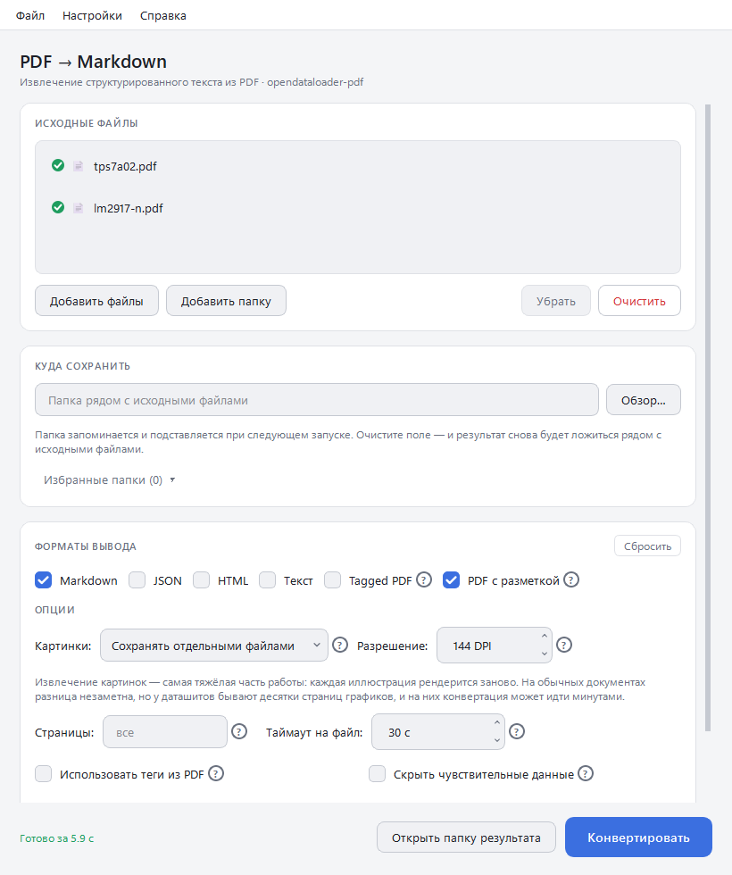

#  PDF → Markdown

[English version](README.md)

Программа для Windows, которая превращает PDF — особенно техническую
документацию и даташиты — в Markdown, JSON, HTML или простой текст.
Перетащили файлы, нажали одну кнопку. Без командной строки, без установки
Python и Java.

Работает на [opendataloader-pdf](https://github.com/opendataloader-project/opendataloader-pdf).

<picture>
  <source media="(prefers-color-scheme: dark)" srcset="docs/screenshot-ru-dark.png">
  
</picture>

## Скачать

Скачайте `PDF-to-Markdown-Setup.exe` со
[страницы релизов](https://github.com/k1llrouz/pdf-to-md-ui/releases) и
запустите. Нужна Windows 10 или 11, 64-битная. Java идёт в комплекте.

Установщик не подписан цифровой подписью, поэтому при первом запуске Windows
SmartScreen может написать, что «защитила компьютер»: нажмите
**Подробнее → Выполнить в любом случае**.

## Как пользоваться

1. Перетащите в окно PDF или целую папку, или прямо на значок программы —
   либо щёлкните по ним правой кнопкой в Проводнике и выберите
   **Открыть в PDF → Markdown** (в Windows 11 — в разделе
   **Показать дополнительные параметры**).
2. Отметьте нужные форматы. По желанию выберите, куда сохранять; по умолчанию
   результат ложится в папку `output` рядом с исходными файлами.
3. Нажмите **Конвертировать**.
4. Значок у каждого файла показывает, как прошло, — подробности во
   всплывающей подсказке. Двойной клик по готовому файлу открывает результат.

Лишний файл убирается из списка кнопкой **Убрать** или клавишей Delete. У
каждой настройки есть **?** с объяснением, а **Справка → Инструкция** (F1)
рассказывает обо всём по порядку — [на русском](docs/guide.ru.md),
[на английском](docs/guide.en.md); она встроена в программу и открывается без
интернета.

## Что она умеет

- **Таблицы не разваливаются.** В Markdown таблицы сохраняются в HTML, поэтому
  объединённые ячейки — основа таблиц Electrical Characteristics в даташитах —
  остаются на месте.
- **Большие файлы её не вешают.** У каждого файла есть таймаут; файл, который в
  него не уложился, повторяется без картинок, а **Отмена** действительно
  останавливает работу. Один битый PDF не останавливает остальную пачку.
- **Даташиты с графиками конвертируются за секунды** благодаря исправлению
  ошибки с памятью в разборщике PDF (подробности [ниже](#исправление-памяти-verapdf)).
- **Ничего не перезаписывается.** Папки сохраняют свою структуру в результате, а
  два файла с одинаковым именем попадают в разные папки.
- **PDF с разметкой** показывает поверх страницы каждую найденную ячейку таблицы
  и каждый блок текста — так быстрее всего понять, почему таблица вышла не так.
- Диапазон страниц, настройки картинок, порядок чтения, способ поиска таблиц,
  пароль PDF; все настройки запоминаются между запусками, а кнопка
  **Сбросить** возвращает раздел к стандартным значениям.
- До пяти избранных папок для результата — переключение одним кликом.
- Шесть языков: English, Русский, Polski, Français, Español, Italiano.
  Программа берёт язык Windows; переключить можно в **Настройки → Язык**.
- Привычное меню Windows — **Файл**, **Настройки**, **Справка** — с обычными
  сочетаниями клавиш (Ctrl+O — добавить файлы, Ctrl+Enter — конвертировать,
  Esc — остановить, F1 — эта инструкция).
- Светлая и тёмная тема или как в Windows — вместе с заголовком окна.
- Сообщает о новой версии: при запуске спрашивает у GitHub, какой релиз
  последний, и показывает ссылку в углу окна. Это единственный запрос — никаких
  данных о вас и ваших файлах он не передаёт. Выключается в **Настройках**,
  проверить вручную — **Справка → Проверить обновления**.
- Одно окно: файлы, отправленные из Проводника, пока программа открыта,
  добавляются в её список, а не открывают вторую копию. Окно открывается
  там же и такого же размера, каким его закрыли.

### Советы для даташитов

- **Страницы** — возьмите описание и таблицы параметров (`1-12`) и пропустите
  десятки страниц графиков.
- **Картинки** занимают больше всего времени. Сначала попробуйте
  **Разрешение 96 DPI**, а если нужны только текст и таблицы — **Не сохранять**.
- Таблица вышла кривой? Отметьте **PDF с разметкой**, чтобы увидеть, что
  распознала программа, и попробуйте **Дополнительно → Таблицы: по кластерам**.

## Для разработчиков

### Запуск из исходников

Нужны Python 3.10+ и Java 11+:

```
python -m venv .venv
.venv\Scripts\activate           # не на Windows: source .venv/bin/activate
pip install -r requirements.txt
python gui.py
```

### Тесты

```
pip install -r requirements-dev.txt
python -m pytest tests
```

Во время прогона окна не открываются (платформа Qt offscreen), а настройки
пишутся во временный файл, а не в реестр. Большинство тестов подменяют Java
маленьким скриптом, поэтому таймауты, отмена и повтор без картинок проверяются
за секунды; `test_real_converter.py` и `test_memory.py` гоняют настоящий jar и
пропускаются, если Java нет. GitHub Actions запускает тесты на каждый push в
`main` и на каждый pull request.

### Сборка

Установщики для раздачи собирает GitHub Actions: при отправке метки `v*`
прогоняются тесты, приложение собирается с Java
[Eclipse Temurin](https://adoptium.net) 21, и `PDF-to-Markdown-Setup.exe`
прикрепляется к релизу.

Локально [build.bat](build.bat) создаёт виртуальное окружение, урезает Java
через `jlink`, запускает PyInstaller и — если установлен Inno Setup — собирает
установщик; программа оказывается в `dist\PDF to Markdown\` (копировать нужно
всю папку, не только exe). Он кладёт в сборку ту Java, что установлена на
компьютере, а лицензия Oracle разрешает раздавать только неизменённый JDK —
поэтому раздавайте сборки из GitHub Actions. Ручные шаги описаны в
[BUILD.md](BUILD.md).

### Куда попадают результаты

| Выбрано | Результат |
|---|---|
| `a.pdf` | `<папка>/a.md` |
| папка `src` с `TI/x.pdf` | `<папка>/TI/x.md` |
| папки `TI` и `ADI` | `<папка>/TI/…`, `<папка>/ADI/…` |
| `a/doc.pdf` и `b/doc.pdf` | `<папка>/doc.md` и `<папка>/doc (2)/doc.md` |

Конвертер называет все результаты по имени исходного файла (`doc.md`,
`doc_images/`, `doc_annotated.pdf`), поэтому одинаковые имена разводятся по
папкам: переименование файлов сломало бы ссылки из `.md` на картинки.

### Исправление памяти veraPDF

В `requirements.txt` закреплён opendataloader-pdf **2.5.13**. Начиная с 2.5.9
в него входит версия veraPDF, которой для разбора векторной графики нужна
память, растущая как квадрат числа штрихов на странице: 48-страничному
даташиту TI вместо 512 МБ стало нужно около 14 ГБ. В [patches/](patches/README.md)
лежит один класс, который это исправляет; он загружается раньше jar, а результат
не меняется ни на байт. Заплатка применяется только к тому jar, на котором
проверена, а `tests/test_memory.py` подскажет, когда она станет не нужна.
Ошибка отправлена разработчикам:
[veraPDF/veraPDF-library#1641](https://github.com/veraPDF/veraPDF-library/issues/1641).

Используемая версия и то, включена ли заплатка, выводятся в начале журнала.

### AI-режим

Для необязательного гибридного режима нужен отдельно запущенный сервер:

```
pip install "opendataloader-pdf[hybrid]"
opendataloader-pdf-hybrid --port 5002
```

Перед началом работы программа проверяет сервер и, если он не отвечает,
предлагает сконвертировать без него.

### Переводы

Все тексты, которые видит пользователь, лежат в `locales/<код>.json`; эталон —
английский `en.json`. Чтобы добавить язык, скопируйте `en.json`, переведите
значения, не трогая ключи и `{подстановки}`, и добавьте код в `LANGUAGES` в
[i18n.py](i18n.py). Тесты проверяют, что в каждом языке есть все ключи и те же
подстановки. Посмотрите окно на минимальной ширине с открытым разделом
**Дополнительно** — длинные надписи не должны выталкивать карточки за край.

### Устройство

| Файл | Назначение |
|---|---|
| `gui.py` | Окно, перетаскивание, запоминание настроек, смена языка |
| `converter.py` | Запуск jar: параметры, куда идёт каждый файл, рабочий поток |
| `single_instance.py` | Одно окно: повторный запуск передаёт файлы первому |
| `updates.py` | Спрашивает у GitHub, нет ли нового релиза |
| `i18n.py`, `locales/` | Языки интерфейса |
| `theme.py` | Цветовые палитры и стили |
| `patches/` | Исправление veraPDF, загружаемое раньше jar |
| `tools/make_icon.py` | Рисует `icon.ico` и `docs/icon.png` |
| `docs/guide.*.md` | Инструкция, которую показывает Справка → Инструкция |
| `tests/` | Тесты pytest, фикстура `table.pdf`, генератор страниц с графиками |
| `build.bat`, `app.spec`, `installer.iss` | Локальная сборка, описание PyInstaller, установщик Inno Setup |
| `.github/workflows/` | Тесты на каждое изменение; установщик по меткам `v*` |

## Лицензия

[GNU General Public License v3.0](LICENSE). Программу можно использовать,
распространять и изменять; любой, кто её распространяет — с изменениями или
без, — обязан передавать исходный код и те же права. Программа поставляется
без каких-либо гарантий.

Сторонние компоненты и их лицензии:
[THIRD_PARTY_NOTICES.md](THIRD_PARTY_NOTICES.md).

Авторы: [bantamer](https://github.com/bantamer) (первая версия),
[k1llrouz](https://github.com/k1llrouz).
